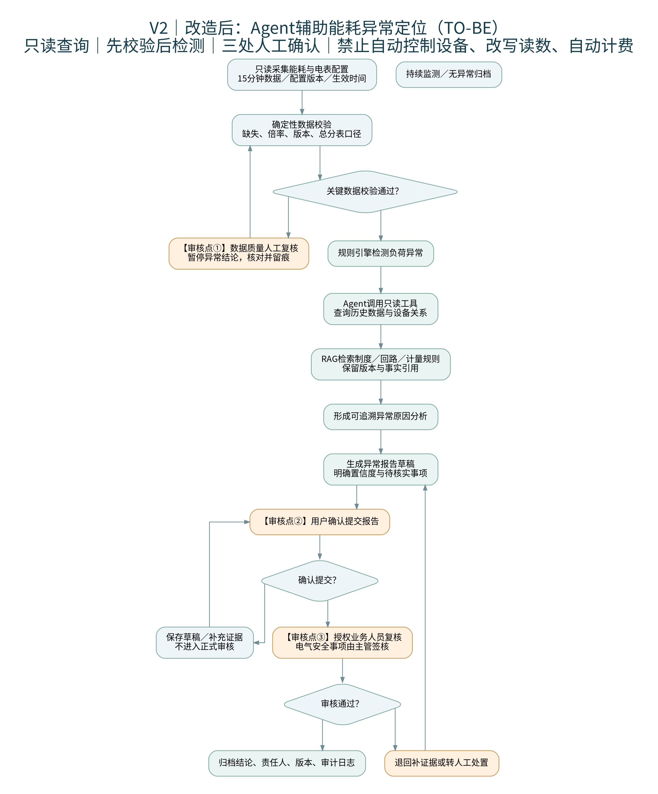

# 瀚川工业园能耗智能体系统需求定义与验收标准

> 证据来源标注约定：F-xx = 顾明岚典型事件访谈事实编号；P-xx = 六人访谈跨岗位痛点编号；energy-consumption-0x = 基础资料编号；CODE:模块 = 仓库实际代码位置。
> 本文档区分三类状态：**已实现**（有代码有测试）、**部分实现**、**待开发**（目标流程中有、代码中没有）。

## 1. 项目概述

### 1.1 项目背景

瀚川工业园电费上升但难以定位具体耗能设备：总表分表读数对不上（energy-consumption-01），空调与生产设备归属不清，管理层希望用 AI 改善但未确定优先环节、验收标准和权限边界。六人访谈确认核心业务目标：单位产出电耗同比上升 14%，改善目标下降 8%；异常定位从约 3 天缩短到半天（F-00，energy-consumption-f00）。

### 1.2 项目目标与范围

- 试点范围：2 栋楼、约 240 块电表、15 分钟采集频率（场景数据，待实际核验）；
- 建设内容：只读数据查询、数据校验、规则异常检测、AI 辅助分析（Agent+RAG）、报告草稿与人工确认、审计留痕；
- 实现方式：历史资料回放先行（试点策略，F-00 关联），不直接替换既有业务流程。

### 1.3 角色与术语

| 角色 | 职责 | 系统内对应 |
|---|---|---|
| 顾明岚·园区能源经理 | 目标、试点决策、验收 | 管理后台看板、报告导出 |
| 林亦舟·机房值守员 | 现场监测与处理 | 问答/异常查询（user 角色） |
| 唐映秋·节能项目专员 | 流程交接、复核发起 | Agent 分析、复核请求 |
| 秦芮·计量数据工程师 | 数据质量、接口 | 数据校验工具、采集导入 |
| 傅景·电气安全主管 | 风险边界、签核 | 审核点③（线下签核） |
| 叶书·租户运营代表 | 计费争议、业务验收 | 试点验收参与方 |

术语：AS-IS/TO-BE（改造前/后流程）、证据编号（系统对每个数据事实签发的可追溯引用）、草稿（AI 生成、未经确认的报告）、签核（授权审批人的业务确认，不等于系统内点击确认）。

## 2. AS-IS 与 TO-BE 分析

### 2.1 AS-IS（改造前流程）

见 `05_业务流程图/01_AI改造前流程图.png`（Mermaid 源码同目录）。要点：人工抄表归集→负荷对比→发现异常→人工查报表→多岗位核对倍率/回路/归属/版本→资料不全则等待返工→人工定位→建议→确认。痛点集中在"资料一致且完整？"判定为否之后的**等待与返工环**（跨岗位补记录、核版本），这与 F-01"各节点等待和处理时间管理层尚未分别量出"互相印证。

### 2.2 TO-BE（改造后流程）

见下图及 `05_业务流程图/02_AI改造后流程图.png`：

关键变化：①确定性数据校验**前置**到检测之前，校验不过直接进审核点①暂停结论；②Agent 只调只读工具查询与组织证据，RAG 保证制度依据可引用；③三处人工审核点（数据质量复核 / 用户确认提交 / 授权人员复核与主管签核）不可跳过；④边界节点明确禁止自动控制设备、改写读数、自动计费。

### 2.3 保留人工确认的环节

1. 倍率错误、版本冲突、关键资料缺失、系统不可用 → 强制人工复核（已实现：`detect_force_review` 5 类判定）；
2. 报告提交确认 → 用户不确认仅保留草稿（已实现：confirm/cancel 四重校验）；
3. 最终业务结论与电气安全事项 → 授权审批人/主管**线下签核**（待开发：系统内写入通道）。

### 2.4 尚未在代码中实现的流程环节

见 §9.8 追溯矩阵"待开发"行及 `05_业务流程图/流程图与现有实现差异核对.md`：15 分钟实时采集调度、持续监测、人工修复队列、审核点③签核写入。

## 3. 业务痛点清单

| 编号 | 痛点 | 来源 | 证据 | 业务影响 | AI 改造方式 | 优先级 | 验证方法 |
|---|---|---|---|---|---|---|---|
| PT-01 | 电表倍率/回路图/生效日期不一致，读数 10 倍放大类假异常 | P-01、典型事件 | 六人访谈§四；F-01 | 异常定位被误导，节能建议失真 | 确定性倍率+版本校验前置，异常转人工（已实现） | P0 | 倍率异常样例强制复核测试通过 |
| PT-02 | 总分表不一致且设备归属不清 | P-02、energy-consumption-01 | 客户简报；F-01 | 账实差异无法归因 | 规则 B 平衡检测+设备关系查询工具（已实现） | P0 | 差异率计算与证据引用核对 |
| PT-03 | 电表配置多版本冲突 | P-01、唐映秋访谈 | 版本选择规则未定 | 核对基准不确定 | 版本字段校验+冲突即转人工（已实现判定） | P0 | 冲突样例触发 force_review |
| PT-04 | 异常定位耗时约 3 天、结论难追溯 | P-03、F-00 | 目标口径 | 管理损耗 | Agent 组织证据+带引用草稿（已实现） | P0 | 试点定位时长统计 |
| PT-05 | 高风险结论缺审批边界 | P-04、傅景访谈 | 岗位要求 | 安全与合规风险 | 权限隔离+强制复核+审计（已实现）；签核写入（待开发） | P0 | 越权 403/审计落库测试 |
| PT-06 | 人工跨系统查询成本高 | 秦芮访谈 | 三套账号权限独立 | 单次取证耗时长 | 只读聚合查询工具 8 个（已实现） | P1 | 工具召回评测 |
| PT-07 | 数据更新延迟无标注 | P-07、秦芮访谈 | 快照降级规则待建 | 旧数据被当新数据 | 数据新鲜度标识（部分实现：采集通道已建，调度未做） | P1 | 待刷新标注用例 |
| PT-08 | 交接责任不明确、缺接手确认 | P-05、唐映秋访谈 | 交接确认未量化 | 返工与争议 | 工单状态机（待开发，MVP 仅复核请求 pending 状态） | P1 | 交接用例 |
| PT-09 | 三套指标口径混用 | P-06、叶书访谈 | 账单/总负荷/单位电耗 | 争议与误判 | 指标口径管理（部分实现：报告区分口径） | P1 | 口径核对 |
| PT-10 | 误判反馈机制不完善 | 叶书访谈 | 周度误判汇总待建 | 规则难改进 | 复核标记+审计（已实现基础），周报闭环（待开发） | P2 | 误判分类统计 |

## 4. 需求分级

**P0（试点必须，对应 MVP 已实现主线）**：只读数据查询、六项数据校验、A/B 规则异常检测、Agent 双通道问答与异常分析、8 工具与五道安全闸、报告草稿与用户确认、RBAC+行级数据范围、审计留痕、限流与 LLM 日预算、Agent 停用开关。

**P1（试点期重要，部分实现）**：实时采集与 15 分钟调度（待开发）、数据新鲜度与快照降级（待开发）、人工修复队列（待开发）、指标口径管理（部分）、报告导出（已实现）、监控指标（已实现）。

**P2（扩展项）**：工单/交接确认状态机、误判周报闭环、统计基线类检测、业务签核写入通道、OCR、PDF 导出。

分级依据：P0 全部有代码与测试支撑（pytest 74 passed、评测 30/30）；P1/P2 按"目标流程 vs MVP 范围"差距矩阵排定，**不得对外声称 P1/P2 已实现**。

## 5. 功能需求规格

格式：编号｜描述｜触发｜输入｜输出｜前置｜正常流程｜异常流程｜权限｜关联模块｜验收标准。状态标注已实现/部分/待开发。

### FR-01 制度知识问答（已实现）
- 触发：用户在问答框提交知识类问题；输入：问题文本；输出：流式回答+引用（doc_id/片段）。
- 前置：知识库就绪（/api/health kb.ready）；流程：混合检索（向量+BM25）→ 依据判定 → 生成（引用不足则拒答）；异常：LLM 超时/失败按配置降级并打前端角标。
- 权限：登录用户；模块：CODE:app/api/chat.py、app/rag/、app/services/chat_service.py。
- 验收：回答含制度原文引用；无依据时明确拒答；引用可点开追溯。

### FR-02 能耗数据查询（已实现）
- 触发：问答中含查询意图或 Agent 规划调用；输入：电表/楼栋/时间范围；输出：读数、区间统计（带证据编号）。
- 权限：登录+行级数据范围（scope_type=buildings 仅授权楼栋）；模块：CODE:app/energy/data_service.py、app/agent/tools.py（query_energy_data）。
- 验收：越权楼栋查询返回 403；数值带证据编号可溯源。

### FR-03 数据校验（已实现）
- 输入：电表读数+配置；校验六项：缺失、倍率、量纲、时间连续、版本生效、总分表口径；输出：issues 列表+validation_status。
- 模块：CODE:app/energy/meter_validator.py、validate_meter_data 工具。
- 验收：倍率异常样例判 issues_found 并触发强制复核（multiplier_anomaly）。

### FR-04 规则异常检测（已实现）
- 规则 A：倍率变化检测；规则 B：总分表平衡差异；输出：六态异常事件+证据行落库。
- 模块：CODE:app/energy/anomaly_detector.py；权限：列表/详情按行级范围过滤。
- 验收：事件含规则号、证据编号、置信区间；重复执行幂等。

### FR-05 Agent 异常分析（已实现）
- 触发：POST /api/agent/analyze（指定 anomaly_id 或自由问题）；输出：SSE 流式分析+证据+报告草稿。
- 约束：只读工具、≤12 次调用、同类工具≤3 次、180s 预算；AGENT_ENABLED 开关停用时 503。
- 模块：CODE:app/agent/loop.py、harness.py、guards.py。
- 验收：评测 30 用例 30/30（mock 口径）；闸触发行为与设计一致。

### FR-06 报告草稿与确认（已实现）
- 流程：草稿生成（页眉标注待复核）→ 用户确认（四重校验：属主/状态/风险请求/内容哈希）或取消（保留草稿）。
- 模块：CODE:app/agent/confirmation.py、app/api/agent.py（drafts confirm/cancel/report 导出）。
- 验收：非属主确认被拒；确认后状态机推进；导出 md/html 带待复核声明。

### FR-07 强制人工复核（已实现判定，修复队列为待开发）
- 5 类触发：multiplier_anomaly / version_conflict / data_missing / safety_risk / ownership_unclear；读取确定性证据，用户取消不能抹掉风险。
- 模块：CODE:app/agent/confirmation.py（detect_force_review）。
- 验收：5 类样例全部触发；复核记录可查（只读）。

### FR-08 行级数据范围（已实现）
- 管理员配置用户↔楼栋 scope；异常列表/详情/Agent 分析强制注入过滤；越权 403。
- 模块：CODE:app/api/users.py（GET/PUT scope）、app/api/anomalies.py、app/api/agent.py。
- 验收：限权用户只见授权楼栋；admin 恒全部且不可自我限权；写审计。

### FR-09 实时采集与调度（待开发）
- 15 分钟调度拉取真实采集系统（授权 A-03），增量落 meter_readings（唯一键防重），延迟超一个周期标"待刷新"，中断用带时间戳快照。
- 现状：幂等导入脚本已实现（CODE:scripts/ingest_meter_batch.py），调度与真实接口待开发。

### FR-10 业务签核写入（待开发）
- 审核点③：授权审批人签核结论落 review_records；电气安全事项由主管签核。
- 现状：复核记录只读展示+报告导出供线下签核（CODE:app/api/anomalies.py reviews 接口），写入通道待开发。

## 6. 非功能需求

| 类别 | 要求 | 现状 |
|---|---|---|
| 性能 | 读接口 P95 < 1s；Agent 分析（mock 口径）P95 < 20s | 已实测：读路径 30 并发 P95 430ms、5xx=0；Agent 30 并发 P95 18.1s（真实 LLM 需重测） |
| 安全 | JWT+bcrypt+CSRF；RBAC+行级范围；限流 240/1200 每分钟；LLM 日预算 50 万 token 熔断 | 已实现并有测试 |
| 可用性 | 前端原生 JS 单页+管理后台 10 页面；异常提示中文统一 | 已实现 |
| 数据一致性 | 采集表唯一键幂等；状态机单向推进；草稿哈希校验 | 已实现 |
| 审计 | 请求→工具调用→执行日志→复核标记→确认动作全链路落库 | 已实现 |
| 故障降级 | LLM 失败降级+角标；AGENT_ENABLED 停用保留人工功能；快照降级（待开发） | 部分实现 |
| 可维护性 | ruff 0 error；pytest 分层；评测回归 30 用例 | 已实现 |
| 可观测性 | /api/health、/api/metrics（Prometheus：请求量/5xx/耗时/工具失败率/当日 token） | 已实现 |
| 部署 | Dockerfile+Compose+33 环境变量；单实例（SQLite/WAL、内存索引） | 配置齐备，**镜像构建待验证** |

## 7. 需求边界

**允许（系统内）**：只读数据查询；数据校验；异常检测；AI 辅助分析；RAG 检索；报告草稿；人工审核；审计留痕。

**禁止（代码与流程双重保证）**：
- 自动控制工业设备——模型无写权、无设备通道；
- 未经授权修改计量数据——原始读数只读，分析不回写；
- 自动确认电费账单/自动批准租户计费——无计费写通道；
- 替代电气安全主管签核——审核点③签核必须由授权人线下完成；
- 绕过权限访问数据——RBAC+行级范围+工具权限码三层拦截。

## 8. 已确认业务指标与设计建议指标（分离）

**已确认业务指标（来自访谈，目标非已实现效果）**：异常定位 3 天→半天；单位产出电耗 +14%→-8%（须剥离产量变化）；账实差异 <1%（试点验收硬线，口径待业务方确认）。

**设计建议指标（本项目建议，待业务确认）**：工具召回 ≥90%；报告证据引用率 100%；误判周反馈闭环 7 天内；月末核对 4 人天→1 人天（回放口径）；试点评价记录保留 90 天后复核归档。

## 9. 需求追溯矩阵

| 访谈事实/证据 | 痛点 | 需求 | 代码模块 | 测试用例 | 验收标准 | 状态 |
|---|---|---|---|---|---|---|
| F-00 目标口径 | PT-04 | FR-05/06 | app/agent/loop.py | tests/evaluation（30 用例） | 评测 30/30；试点时长统计 | 已实现 |
| F-01 节点耗时未量化 | PT-04 | FR-05 | app/agent/tools.py | tests/integration/test_chat_agent.py | 分析报告含各环节证据 | 已实现 |
| 六人访谈§四 倍率事件 | PT-01/03 | FR-03/07 | meter_validator、detect_force_review | test_phase11_gaps 等 | 倍率异常强制复核 | 已实现 |
| P-02 总分表 | PT-02 | FR-04 | anomaly_detector(RuleB) | 评测用例 | 差异率+证据 | 已实现 |
| P-04 傅景审批边界 | PT-05 | FR-05/07/08 | guards、permissions | test_auth_rbac、test_security | 越权 403；签核线下 | 已实现（签核写入待开发） |
| P-05 交接确认 | PT-08 | FR-10 | — | — | 工单状态机 | **待开发** |
| P-07 接口延迟 | PT-07 | FR-09 | ingest_meter_batch | test_phase11_gaps（幂等） | 调度+快照降级 | **部分/待开发** |
| energy-consumption-01 边界 | 全部 | §7 边界 | guards 五道闸 | test_selftest_suites | 禁止项全数拦截 | 已实现 |

## 10. 验收标准

### 10.1 功能验收（试点硬线）
1. 评测集 30 用例全部通过（当前 mock 口径 30/30；接入真实 LLM 后须复测并留基线）；
2. 越权访问（跨楼栋、跨角色、未登录）全部 401/403；
3. 倍率异常/版本冲突/数据缺失/安全风险/归属不明 5 类样例 100% 触发强制复核；
4. 报告草稿未经确认不得进入已确认状态；导出件含待复核声明；
5. 限流 429、预算 429、停用 503 行为符合设计。

### 10.2 非功能验收
1. 读路径 30 并发 P95 < 1s、5xx=0；Agent 链路 5xx=0（回放口径，真实 LLM 后重测）；
2. /api/metrics 可被抓取且指标齐全；备份恢复演练通过（恢复后行数一致）；
3. pip-audit 0 已知高危漏洞。

### 10.3 业务验收（待业务方确认基线后执行）
1. 账实差异 <1%（分母、排除规则、统计周期需业务方书面确认）；
2. 异常定位时长由试点样本统计，目标半天内（样本量待定）；
3. 电耗降幅 8% 须剥离产量变化、扣除维护与复核成本，**不作为结算依据**；
4. 叶书（租户运营代表）参与试点验收；傅景（电气安全主管）对风险边界有一票否决权。
