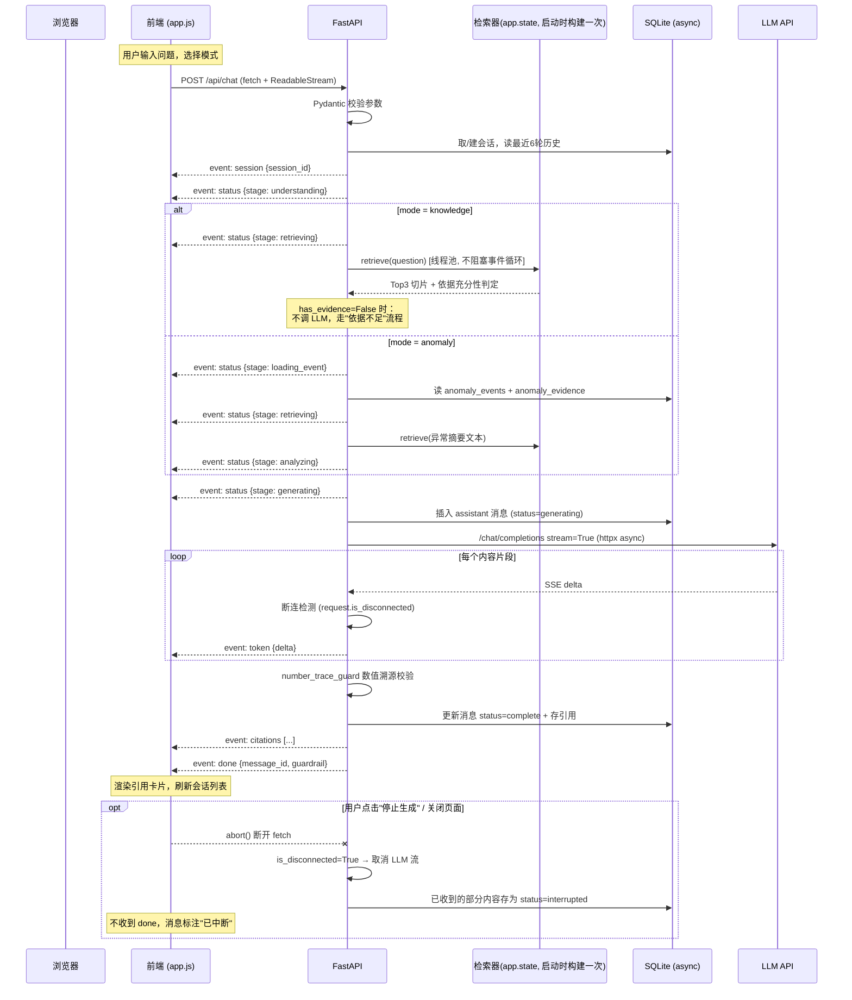

# 瀚川工业园 · 阶段4 接口与交互设计方案

**版本 v0.9（待确认稿）** —— 确认后升 v1.0 作为开发基线，然后进入代码实现。

**范围**：用户端聊天界面 + FastAPI 接口 + SSE 流式通信 + SQLite 持久化。面向能源经理 / 机房值守 / 节能专员三类用户，不做多角色管理后台。

**基线**：本方案全部复用阶段 3 已实测的模块（检索 5 问全命中 / 无关问题拒答 / 异常 3/3 命中 / LLM 故障降级），模块映射基于 `prototype/energy_agent.py`（2602 行）的真实代码结构，见第七节。

---

## 〇、三处对需求文本的工程化补充（需确认）

需求文本有三处若照字面实现会自相矛盾，本方案做了最小扩展，先行声明：

| # | 需求原文 | 矛盾点 | 本方案处理 |
|---|---|---|---|
| E1 | `POST /api/chat` 参数仅 `session_id / question / mode` | 但"方式二：选择异常事件"要求后端知道用户选了哪条事件，仅靠 question 传不了结构化 ID | 请求体增加**可选字段 `anomaly_id`**。为空且 mode=anomaly 时，从 question 中正则提取电表号 / 事件号，仍取不到则返回 `PARAM_INVALID` 提示选择事件或指明电表 |
| E2 | "不允许将失败或中断的回答误标记为完整回答" | 消息表若无状态字段，无从区分 | `messages` 表增加 **`status`** 字段（`generating / complete / interrupted / failed`），见第五节 |
| E3 | "区分知识库文档依据和能耗数据证据" | 引用表无类型字段则无法区分 | `message_citations` 表增加 **`source_type`**（`knowledge / anomaly_data`），见第五节 |

另有一处主动澄清：需求"最近 6 轮历史"按 **6 组（用户+助手）消息对**实现，且**只取 `status IN (complete, interrupted)` 的助手消息**——`failed` 的空壳回答进入历史只会污染上下文。

---

## 一、系统整体交互流程图

### 1.1 两种模式的端到端时序



### 1.2 文字版要点

1. **检索器只在应用启动时构建一次**（lifespan 阶段），挂在 `app.state.retriever`，请求期只读不写——FAISS 索引构建是分钟级操作（含 Embedding），绝不能进请求路径。阶段 3 的 `.cache` 磁盘缓存机制保留，二次启动秒级加载。
2. **同步检索跑在线程池**（`anyio.to_thread.run_sync`）。检索是 CPU/网络混合操作（hash 向量毫秒级；api Embedding 秒级），不丢线程池会卡住事件循环，拖垮所有并发请求。
3. **LLM 流式用 httpx AsyncClient**，`stream=True` 增量读取——这是阶段 3 `call_llm`（一次性返回）没有的能力，需新增函数，见第七节。
4. **消息先行落库**（`status=generating`），流结束才改成 `complete`——这样服务重启也能在库里看到"哪些回答没生成完"，不误标。
5. **anomaly 模式检索的 query 不是用户原话**，而是异常事件的结构化摘要（"电表 M-002 倍率 10→100 待核查 总分表差异"）——阶段 3 实测这样召回的才是排查流程和复核规范，用用户原话（"为什么用电量突然增加"）召回质量差。

---

## 二、API 接口清单

| 方法 | 路径 | 功能 | 响应类型 |
|---|---|---|---|
| POST | `/api/chat` | AI 聊天（双模式，SSE 流式） | `text/event-stream` |
| GET | `/api/sessions` | 历史会话列表（按 updated_at 倒序） | JSON |
| GET | `/api/sessions/{session_id}/messages` | 指定会话消息（含引用） | JSON |
| GET | `/api/anomalies` | 异常事件列表 | JSON |
| GET | `/api/anomalies/{anomaly_id}` | 异常事件详情（含证据） | JSON |
| GET | `/` | 聊天页面 index.html | HTML |
| GET | `/static/*` | 静态资源（css/js） | 静态文件 |
| GET | `/api/health` | 健康检查（含知识库/LLM 状态） | JSON |

> 静态页面与 `/api/health` 不在需求清单内，但单页应用需要宿主，运维需要探活，成本近零。

---

## 三、接口请求 / 响应结构

### 3.1 POST /api/chat

**请求体**：

```json
{
  "session_id": "conv-20261105-0001",
  "question": "为什么 METER_001 的用电量突然增加？",
  "mode": "anomaly",
  "anomaly_id": "AN-20261023-0001"
}
```

| 字段 | 类型 | 必填 | 说明 |
|---|---|---|---|
| session_id | string | 否 | 为空由服务端创建并经 `session` 事件返回 |
| question | string | 是 | 1–500 字 |
| mode | enum | 是 | `knowledge` / `anomaly`，缺省 `knowledge` |
| anomaly_id | string | 否 | 扩展字段 E1，anomaly 模式的事件定位 |

**成功**：HTTP 200 + SSE 流（见第四节）。

**建立流之前的错误**（HTTP 状态码 + 统一 JSON 错误体）：

| 场景 | 状态码 | code |
|---|---|---|
| question 为空/超长、mode 非法 | 422 | `PARAM_INVALID` |
| anomaly_id 在库中不存在 | 404 | `ANOMALY_NOT_FOUND` |
| anomaly 模式且无法定位事件（无 id、正则也没提取到电表号） | 400 | `ANOMALY_NOT_SPECIFIED` |
| session_id 存在但库里没有 | 404 | `SESSION_NOT_FOUND` |
| 知识库未初始化（启动失败兜底） | 503 | `KB_NOT_READY` |
| 数据库异常 | 500 | `DB_ERROR` |
| 检索异常 | 500 | `RETRIEVE_FAILED` |
| LLM 配置缺失或首次连通性探测失败 | 503 | `LLM_UNAVAILABLE`（此时降级为 mock 模式则不报此错，见第八节） |

### 3.2 GET /api/sessions

**响应**：

```json
{
  "items": [
    {
      "session_id": "conv-20261105-0001",
      "title": "为什么 METER_001 的用电量突然增加？",
      "mode": "anomaly",
      "created_at": "2026-11-05T20:10:00",
      "updated_at": "2026-11-05T20:12:33",
      "message_count": 8
    }
  ],
  "total": 3
}
```

标题规则：取该会话**第一条用户消息前 30 字**；查询按 `updated_at DESC`。`mode` 取该会话最近一次使用的模式，供前端在会话列表打标签。

### 3.3 GET /api/sessions/{session_id}/messages

**响应**：

```json
{
  "session_id": "conv-20261105-0001",
  "items": [
    {
      "id": 101,
      "role": "user",
      "content": "为什么 METER_001 的用电量突然增加？",
      "mode": "anomaly",
      "status": null,
      "created_at": "2026-11-05T20:10:00",
      "citations": []
    },
    {
      "id": 102,
      "role": "assistant",
      "content": "## 异常现象\n……",
      "mode": "anomaly",
      "status": "complete",
      "created_at": "2026-11-05T20:10:05",
      "guardrail_passed": true,
      "citations": [
        {
          "source_type": "knowledge",
          "source_file": "02_电表倍率与计量单位管理规范.md",
          "chunk_id": "02_电表倍率与计量单位管理规范::c002",
          "excerpt": "电表倍率发生变更时，应在 24 小时内核对……"
        },
        {
          "source_type": "anomaly_data",
          "source_file": "energy_readings",
          "chunk_id": "AN-20261023-0001/evidence/R04",
          "excerpt": "旧倍率 10.0 → 新倍率 100.0，变化 10 倍，变更前后电量中位数 3.52 → 39.4 kWh"
        }
      ]
    }
  ]
}
```

会话不存在 → 404 `SESSION_NOT_FOUND`。用户消息 `status` 恒为 `null`。

### 3.4 GET /api/anomalies

**响应**：

```json
{
  "items": [
    {
      "anomaly_id": "AN-20261023-0001",
      "meter_id": "M-002",
      "building_id": "B1",
      "anomaly_type": "电表倍率变化待核查",
      "rule_code": "R04_RATIO_CHANGE",
      "severity": "high",
      "detected_at": "2026-10-23T12:00:00",
      "status": "pending_review",
      "evidence_count": 5,
      "summary": "倍率在 2026-10-23 12:00 前后由 10 变为 100（10.0 倍）……"
    }
  ],
  "total": 3
}
```

支持 `?status=` 过滤（`pending_review / confirmed / dismissed`）。**本阶段 status 只由人工在数据库层面维护，不做修改接口**——"不自动生成最终结论"的边界保持。

### 3.5 GET /api/anomalies/{anomaly_id}

**响应**（节选关键字段）：

```json
{
  "anomaly_id": "AN-20261023-0001",
  "meter_id": "M-002",
  "anomaly_type": "电表倍率变化待核查",
  "window": {"start": "2026-10-23T11:45:00", "end": "2026-10-23T12:00:00"},
  "rule_result": {
    "rule_code": "R04_RATIO_CHANGE",
    "metrics": {"旧倍率": 10.0, "新倍率": 100.0, "变化倍数": 10.0, "变更前电量中位数_kWh": 3.521}
  },
  "evidence": [
    {"evidence_type": "rule_metric", "content": "旧倍率=10.0 新倍率=100.0", "source_reference": "meters.config"},
    {"evidence_type": "reading", "content": "2026-10-23 12:00 raw_reading=136.474839", "source_reference": "energy_readings#M-002"}
  ],
  "related_meters": ["M-002", "MT-B1"],
  "status": "pending_review"
}
```

事件不存在 → 404 `ANOMALY_NOT_FOUND`。**只读**：本接口及全阶段不提供任何修改能耗数据或异常事件的写接口。

---

## 四、SSE 事件协议

### 4.1 事件总表

| event | data 结构 | 发送时机 | 顺序 |
|---|---|---|---|
| `session` | `{"session_id": "...", "created": true}` | 会话确定后立即 | 1 |
| `status` | `{"stage": "...", "text": "正在检索能源管理知识库……"}` | 每个真实阶段边界 | 2–5（见下） |
| `token` | `{"delta": "倍率"}` | LLM 每返回一个内容片段 | 6+（0..N 次） |
| `citations` | `{"items": [Citation...]}` | 生成完毕、校验通过后 | 倒数第二 |
| `done` | `{"message_id": 102, "status": "complete", "guardrail": {"passed": true, "checked": 23, "missed": 0}}` | 流结束 | 最后 |
| `error` | `{"code": "...", "message": "...", "details": null}` | 流中任何失败 | 终止事件（之后不再有任何事件） |

**status 阶段与真实执行点一一对应**（无固定延时模拟）：

| stage | text | 真实触发点 |
|---|---|---|
| `understanding` | 正在理解问题…… | 参数校验通过、历史读取前 |
| `retrieving` | 正在检索能源管理知识库…… | `retriever.retrieve()` 调用前 |
| `loading_event` | 正在读取异常事件…… | 仅 anomaly 模式，查 DB 前 |
| `analyzing` | 正在分析能耗异常…… | 仅 anomaly 模式，Prompt 构建前 |
| `generating` | 正在生成回答…… | LLM 首个请求发出前 |

**事件顺序**（成功流）：
`session → status(understanding) → [status(loading_event) → status(retrieving) → status(analyzing)] 或 [status(retrieving)] → status(generating) → token×N → citations → done`

**依据不足流**（knowledge 模式，阶段 3 `has_evidence` 判 False）：
`session → status(understanding) → status(retrieving) → error{code: "NO_EVIDENCE", message: "知识库中未找到与该问题相关的内容，无法提供有依据的回答……"}`
—— 不调 LLM、不落 assistant 消息（或落 `failed` 空消息，见 4.4），把决定权留给用户换问法。

### 4.2 SSE 原始报文示例

```text
event: session
data: {"session_id": "conv-20261105-0001", "created": true}

event: status
data: {"stage": "retrieving", "text": "正在检索能源管理知识库……"}

event: token
data: {"delta": "## 异常现象"}

event: token
data: {"delta": "\n电表 M-002 倍率在 10-23 12:00 前后由 10 变为 100。"}

event: citations
data: {"items": [{"source_type": "knowledge", "source_file": "02_电表倍率与计量单位管理规范.md", "chunk_id": "...", "excerpt": "电表倍率发生变更时，应核对……"}]}

event: done
data: {"message_id": 102, "status": "complete", "guardrail": {"passed": true, "checked": 23, "missed": 0}}
```

每事件以空行（`\n\n`）分隔；`data` 一律单行 JSON（内部换行已转义）。

### 4.3 前端解析方式

不用 `EventSource`（它只支持 GET，无法 POST），用 **fetch + ReadableStream 手工解析**：

```javascript
const resp = await fetch("/api/chat", {
  method: "POST",
  headers: { "Content-Type": "application/json" },
  body: JSON.stringify({ session_id, question, mode }),
  signal: abortController.signal,        // 停止生成用
});
if (!resp.ok) { /* HTTP 错误：统一 JSON 错误体 */ }

const reader = resp.body.getReader();
const decoder = new TextDecoder();
let buf = "", currentEvent = null;
while (true) {
  const { value, done } = await reader.read();
  if (done) break;
  buf += decoder.decode(value, { stream: true });
  let idx;
  while ((idx = buf.indexOf("\n\n")) !== -1) {      // 按事件分帧
    const frame = buf.slice(0, idx); buf = buf.slice(idx + 2);
    for (const line of frame.split("\n")) {
      if (line.startsWith("event: ")) currentEvent = line.slice(7).trim();
      else if (line.startsWith("data: ")) handle(currentEvent, JSON.parse(line.slice(6)));
    }
  }
}
```

`handle()` 按 `currentEvent` 分发：`status` → 更新状态条；`token` → 追加气泡内容（首次收到 token 时清掉状态条）；`citations` → 暂存；`done` → 定稿、刷新会话列表；`error` → 展示中文错误、消息标失败。

### 4.4 停止、断线、超时与存储语义

**核心原则：消息的最终状态由"最后一个到达的信号"决定，且从不无凭据地写 complete。**

| 情形 | 服务端行为 | 消息落库 | 前端表现 |
|---|---|---|---|
| 正常完成 | 发 `citations` + `done` | `status=complete`，引用入库 | 正常定稿 |
| 用户点"停止生成"（fetch abort） | token 循环中 `request.is_disconnected()` 为真 → 取消 httpx 流 → 跳出循环 | 已累积内容存入，`status=interrupted` | 无 done 事件，abort 被 catch 后本地把气泡标注"已停止（内容不完整）"，刷新后从历史读到 `interrupted` 状态同样标注 |
| 网络断线（同上，被动） | 同上 | 同上（`interrupted`） | 重连后刷新可见 |
| LLM 流中途报错/超时 | 发 `error` 事件后结束响应 | 已累积内容存入，`status=failed`，`error` 详情存 `messages.error_info` | 红色错误条 + 中文提示，气泡标"生成失败" |
| 服务进程崩溃/重启 | 无法发事件 | 库里留着 `status=generating` 的悬挂消息 | 刷新后历史里显示"生成中断"，启动时把 `generating` 超过阈值的旧消息统一改标 `failed`（自愈） |

**历史读取规则**（对 1.2 第 4 条的呼应）：读历史做上下文时只取 `complete/interrupted` 的助手消息——中断消息内容是真实的部分输出，可作上下文；`failed/generating` 排除。

---

## 五、SQLite 数据库表设计

SQLAlchemy 2.x 声明式模型，全部主键自增、时间字段存 ISO8601 UTC 字符串（PG 迁移友好）。

### 5.1 表结构

**conversations（会话表）**

| 字段 | 类型 | 说明 |
|---|---|---|
| id | String(36) PK | `conv-<uuid>`，服务端生成 |
| title | String(64) | 首条用户消息前 30 字 |
| created_at | DateTime | 建会话时间 |
| updated_at | DateTime | 每条消息后更新，列表排序键 → **索引** |

**messages（消息表）**

| 字段 | 类型 | 说明 |
|---|---|---|
| id | Integer PK | |
| conversation_id | String(36) FK→conversations.id | **索引**（会话内取历史是最高频查询） |
| role | String(16) | `user` / `assistant` |
| content | Text | 消息正文 |
| mode | String(16) | 该消息产生时的模式 |
| status | String(16) | `generating/complete/interrupted/failed`，用户消息为 NULL（扩展 E2） |
| error_info | Text NULL | failed 时的错误 JSON |
| guardrail_passed | Boolean NULL | 仅 anomaly 模式助手消息：数值溯源结果 |
| created_at | DateTime | → 复合索引 `(conversation_id, id)` 支撑"取最近 N 条" |

**message_citations（消息引用表）**

| 字段 | 类型 | 说明 |
|---|---|---|
| id | Integer PK | |
| message_id | Integer FK→messages.id | **索引** |
| source_type | String(16) | `knowledge` / `anomaly_data`（扩展 E3） |
| source_file | String(256) | 知识库文件名 / 证据来源标识 |
| chunk_id | String(128) | 知识库切片 ID（可回查原文） |
| excerpt | String(160) | **截断存储**：前 120 字 + 省略号 |

**存储策略（对应"避免重复存储大量知识库文本"）**：引用表只存**定位键 + 短摘录**，不存 500 字全文。知识库全文在 FAISS 缓存（`.cache/chunks.json`）里，`chunk_id` 可精确回查；摘录仅供列表页快速浏览，展开详情时前端可用 chunk_id 调 `GET /api/knowledge/chunks/{chunk_id}` 取全文（该接口列入 P1，首期靠摘录即可）。

**anomaly_events（异常事件表）**

| 字段 | 类型 | 说明 |
|---|---|---|
| id | String(32) PK | 检测产出的 `AN-YYYYMMDD-NNNN`，确定性 ID |
| meter_id | String(32) | → **索引**（按表查询是高频路径） |
| building_id | String(16) | |
| anomaly_type | String(64) | 中文类型名 |
| rule_code | String(32) | `R04_RATIO_CHANGE` / `R05_BALANCE_DIFF` |
| severity | String(8) | high / medium / low |
| detected_at | DateTime | 事件窗口起点 |
| window_start / window_end | DateTime | |
| description | Text | 人可读摘要 |
| rule_result | JSON | 指标字典（SQLAlchemy `JSON` 类型，SQLite 存 TEXT、PG 可平滑换 JSONB） |
| status | String(16) | `pending_review / confirmed / dismissed` |

**anomaly_evidence（异常证据表）**

| 字段 | 类型 | 说明 |
|---|---|---|
| id | Integer PK | |
| anomaly_id | String(32) FK→anomaly_events.id | **索引** |
| evidence_type | String(32) | `rule_metric / reading / balance_calc` |
| evidence_content | Text | 证据原文（由规则引擎产出，**不经过 LLM**） |
| source_reference | String(128) | 数据定位（表#行） |

### 5.2 关系与初始化

```
conversations 1 ──< messages 1 ──< message_citations
anomaly_events 1 ──< anomaly_evidence
```

- 级联删除：会话删除 → 级联消息、引用（本阶段无删除接口，约束先行）。
- 初始化：启动时若 `anomaly_events` 为空 → 运行阶段 3 检测链（load_readings → compute_intervals → detect_all，异常数据集 + 正常数据集）落库；非空则跳过。**确定性事件 ID 保证幂等**，重复启动不重复插入。
- PG 迁移性：不使用任何 SQLite 方言特性（AUTOINCREMENT 裸用、`PRAGMA` 查询全部封装在 repo 层）；JSON 字段走 `sa.JSON`；`String` 显式长度。迁移时改连接串 + 建表方言即可。

---

## 六、前端页面布局方案

### 6.1 线框

```
┌──────────────┬────────────────────────────────────────────┐
│ 瀚川工业园     │  会话标题区（含模式标签 ●知识问答 / ●异常分析）      │
│ 能耗异常定位    ├────────────────────────────────────────────┤
│ 智能体         │                                            │
│              │   [用户气泡]        为什么METER_001用电量突增？  │
│ [+ 新建会话]   │                                            │
│              │   [AI 回答区]                                │
│ ── 历史会话 ── │   正在检索能源管理知识库……（状态条，随真实阶段）      │
│ · 会话A 20:12 │   ## 异常现象                                │
│ · 会话B 昨天   │   电表M-002倍率在……（流式追加）                 │
│ · 会话C 11-02 │   ────────────────                         │
│              │   参考依据 (2) ▾                              │
│ ── 快捷入口 ── │   📄 02_电表倍率与计量…规范.md [展开]           │
│ [能源知识问答]  │   ⚡ 数据证据 · R04 倍率10→100 [展开]          │
│ [能耗异常分析]  │   ⚠ AI草稿·未经人工复核                        │
│              ├────────────────────────────────────────────┤
│ (折叠按钮)     │  [输入框………………………………] [发送] [■停止] 460/500  │
└──────────────┴────────────────────────────────────────────┘
```

点击"能耗异常分析"入口 → 右侧滑出**异常事件面板**（列表：编号/设备/类型/时间/状态，每条带"AI 分析"按钮）→ 点击后自动填入 `mode=anomaly` + `anomaly_id` + 引导问题并发送。这是"方式二"的交互载体。

### 6.2 视觉与行为规范

| 项 | 方案 |
|---|---|
| 配色 | 白底 `#fff` / 浅灰面板 `#f5f7fa` / 主色蓝 `#1e6fff` / 用户气泡浅蓝、AI 白底灰边框 |
| 布局 | 桌面：左栏 280px 固定 + 弹性主区；≤768px：左栏折叠为抽屉，单列 |
| 动画 | 仅 token 逐字追加（无过渡动画），状态条用三点省略号 |
| AI 回答渲染 | 简易 Markdown 渲染（标题/加粗/列表/代码块/表格），**渲染前先转义 HTML**，防 LLM 输出注入脚本 |
| 状态条 | 一条固定高度的行，按 status 事件替换文案，首个 token 到达即隐藏 |
| 引用卡片 | 默认收起只显示文件名，点击展开摘录；knowledge 用 📄 图标、anomaly_data 用 ⚡，色带区分 |
| 中断/失败标识 | 气泡底部小字："已停止，内容不完整" / "生成失败：<中文原因>"，灰色/红色 |
| 长会话 | 聊天区虚拟滚动不做（本阶段会话短），仅"加载更多"分页 50 条 |
| 停止按钮 | 生成中显示，abort 当前 fetch；点击后按钮恢复为"发送" |
| 网络异常 | fetch reject → 顶部黄色横幅："网络连接异常，请检查网络后重试"；SSE error 事件 → 气泡内红色提示 |

### 6.3 前端状态机（单条 AI 消息）

```
待发送 → (POST) → 等待session → 状态条轮转(understanding/retrieving/…)
      → 收到首个token → 流式追加
      → done → 定稿(渲染引用)                [complete]
      → error → 错误提示                      [failed]
      → 用户abort → "已停止，内容不完整"        [interrupted]
```

三条终态与后端 `messages.status` 严格一致，前端不自行猜测。

---

## 七、阶段 3 模块复用与改造方案

### 7.1 拆分映射表

新后端包结构 `backend/app/`，从 `energy_agent.py`（2602 行）按下表拆出（**约 70% 代码原样迁移**）：

| 阶段 3 符号（原文件行号） | 新位置 | 复用方式 | 改造点 |
|---|---|---|---|
| `load_markdown_chunks` `pack_paragraphs` `_split_long_paragraph` `Chunk` (533–733) | `core/loader.py` | ✅ 直接复用 | 无（纯函数） |
| `BaseEmbedder` `HashEmbedder` `ApiEmbedder` `SentenceTransformerEmbedder` `build_embedder` (328–478) | `core/embedder.py` | ✅ 直接复用 | `ApiEmbedder` 从 requests 改 httpx 同步客户端（仅启动期调用，不进请求路径，改不改都行——**不改**，降低回归风险） |
| `VectorIndex`（FAISS 封装，含 Windows 中文路径字节流落盘的坑）(734–802) | `core/vector_store.py` | ✅ 直接复用 | 无 |
| `SimpleBM25` `BM25Index` `_bm25_doc_tokens` (802–892) | `core/bm25.py` | ✅ 直接复用 | 无 |
| `rrf_fuse` `Retrieved` `HybridRetriever` `has_evidence` (868–1086) | `core/retriever.py` | ✅ 复用 | 类去掉 `CFG` 全局依赖，构造参数注入；`build_or_load` 逻辑不动 |
| `tokenize_zh` `normalize_query` (289–328) | `core/text.py` | ✅ 直接复用 | 无 |
| `call_llm` `_mock_llm` `LLMError` (1086–1284) | `core/llm.py` | ⚠ 部分改造 | 保留同步 `call_llm`（降级路径用）；**新增** `call_llm_stream()`：httpx.AsyncClient + stream=True，async generator 逐段 yield；mock 模式下把整段答案按 ~30 字切分逐段 yield（离线也能验证前端流式渲染） |
| `build_qa_prompt` `build_anomaly_prompt` `build_evidence_payload` (1284–2013) | `core/prompts.py` | ⚠ 小改 | 增加 `history: list[dict]` 参数拼进 Prompt（阶段 3 无多轮）；模板字符串加版本号注释 |
| `load_readings` `compute_intervals` `Reading` `Interval` `RuleA_RatioChange` `RuleB_BalanceDiff` `detect_all` `AnomalyEvent` (1323–1865) | `core/rules.py` | ✅ 直接复用 | 无——规则引擎是系统的确定性基座，一行不动 |
| `number_trace_guard` `extract_numbers` (1865–1930) | `core/guardrail.py` | ✅ 直接复用 | 无 |
| `Config.load` (126–200) | `core/config.py` | ⚠ 改造 | 换 Pydantic Settings（BaseSettings + env 前缀），字段与默认值**逐项保持**，.env 直接兼容 |
| `analyze_anomaly` (2013–2064) | 服务层重组 | ♻ 重写 | 原函数一次性返回；服务层改为状态机式分步（检索→prompt→流式生成→校验），但**内部算法全部调用上述复用件** |
| 终端渲染 / 菜单 / `action_*` / `run_demo` (203–289, 2141–2602) | ❌ 不迁移 | 丢弃 | CLI 层，由前端替代 |

### 7.2 后端新增目录结构（实现阶段的骨架）

```
backend/
├─ app/
│  ├─ main.py              # FastAPI 实例、lifespan（构建检索器+初始化DB+落异常事件）
│  ├─ api/
│  │  ├─ chat.py           # POST /api/chat（SSE）
│  │  ├─ sessions.py       # 会话列表/消息
│  │  └─ anomalies.py      # 异常列表/详情
│  ├─ services/
│  │  ├─ chat_service.py   # 双模式编排：历史→检索→prompt→流→校验→落库
│  │  └─ history.py        # 6轮历史读取与预算截断
│  ├─ core/                # ← 上表拆出的阶段3模块
│  ├─ db/
│  │  ├─ models.py         # SQLAlchemy 模型（第五节）
│  │  ├─ repo.py           # 仓储层（会话/消息/异常）
│  │  └─ session.py        # async_sessionmaker 工厂
│  ├─ schemas/             # Pydantic 请求/响应模型
│  └─ errors.py            # 统一错误码 + exception handler
├─ static/                 # index.html / app.css / app.js
├─ knowledge_base/  data/  .env  (沿用阶段3的)
└─ requirements.txt        # fastapi uvicorn sqlalchemy aiosqlite httpx + 阶段3依赖
```

### 7.3 并发与生命周期红线（对应需求三条"特别注意"）

1. **FAISS 索引只在 lifespan 构建一次**：`app.state.retriever`，请求期只读。FAISS `search` 线程安全，BM25 只读数组，无锁需求。缓存沿用 `.cache/`，冷启动一次构建、热启动秒级。
2. **阻塞操作全部出事件循环**：`retrieve()`、`number_trace_guard()`、BM25 检索经 `anyio.to_thread.run_sync` 包一层；LLM 用 httpx 异步流。事件循环里只剩 IO 等待。
3. **数据库会话**：`async_sessionmaker`，每请求 `async with session.begin()`，**绝无全局共享 session**；SQLite 开 WAL 模式（`PRAGMA journal_mode=WAL`）允许多读单写并发，写冲突由 SQLAlchemy 重试一次兜底。
4. **API Key 只存在服务端 env**：前端拿到的响应里不含任何密钥、base_url；静态目录白名单（css/js/ico），不暴露 .env。

---

## 八、关键异常处理机制

### 8.1 统一 JSON 错误结构（非流式接口 + SSE 建流前）

```json
{ "code": "ANOMALY_NOT_FOUND", "message": "异常事件不存在或已被删除", "details": {"anomaly_id": "AN-XXXX"} }
```

| code | HTTP | 触发场景 | 中文 message 示例 |
|---|---|---|---|
| `PARAM_INVALID` | 422 | 参数校验失败 | 问题不能为空，且不超过 500 字 |
| `ANOMALY_NOT_SPECIFIED` | 400 | anomaly 模式无法定位事件 | 请选择具体异常事件，或在问题中指明电表编号 |
| `SESSION_NOT_FOUND` | 404 | 会话 ID 无效 | 会话不存在或已过期 |
| `ANOMALY_NOT_FOUND` | 404 | 事件 ID 无效 | 异常事件不存在或已被删除 |
| `KB_NOT_READY` | 503 | 启动构建失败 | 知识库尚未初始化完成，请稍后重试或联系管理员 |
| `LLM_UNAVAILABLE` | 503 | 探测失败且未启用降级 | 模型服务当前不可用 |
| `DB_ERROR` | 500 | 数据库操作失败 | 数据读写异常，请稍后重试 |
| `RETRIEVE_FAILED` | 500 | 检索抛异常 | 知识检索失败，请重试 |
| `TIMEOUT` | 504 / error事件 | LLM 超过 LLM_TIMEOUT | 模型响应超时，请重试 |
| `GENERATION_CANCELLED` | error事件 | 用户停止 | 已停止生成 |
| `NO_EVIDENCE` | error事件 | 依据不足 | 知识库中未找到与该问题相关的内容，无法提供有依据的回答。建议换一种问法或补充知识文档 |

### 8.2 SSE 内错误 vs HTTP 错误的边界

- **建流前**（参数校验、会话/事件查询、KB 状态检查）：直接返回 4xx/5xx + JSON 错误体，`Content-Type: application/json`，不进入流。
- **建流后**（检索失败、LLM 超时/网络断、生成中途异常）：发 `event: error` + 同结构 JSON，然后结束 chunked 响应。**error 是流的终止事件**，前端收到后不再期待任何内容。
- 降级路径：LLM API 失败时，**若配置了 `LLM_FALLBACK_MOCK=true`（默认 true）**，转 mock 生成并在 done 事件的 data 里带 `"llm_mode": "mock_offline"`，前端显示"离线模拟模式"角标——阶段 3 已验证的降级语义平移到 Web 端。未配置降级才发 `LLM_UNAVAILABLE` error。

### 8.3 自愈与一致性

- 启动时扫描 `messages WHERE status='generating'` 且 `updated_at` 早于启动时间 → 统一改 `failed`（进程崩溃遗留的悬挂消息）。
- 6 轮历史、会话列表查询都排除/正确处理非 complete 消息（4.4 节规则）。
- 每条 assistant 消息的引用**只来自当次检索的真实返回**（`Retrieved` 列表直接序列化），Prompt 里也只放这些片段——LLM 想编造引用无渠道；`citations` 事件由服务端在 LLM 输出之外独立组装，**不经模型转手**。

---

## 九、阶段 4 最小可运行版本（MVP）验收标准

**阻塞项（不过不发版）**：

1. `uvicorn app.main:app` 启动后浏览器打开 `http://127.0.0.1:8000/`，页面完整可用（含移动端 375px 宽度不破版）。
2. knowledge 模式：5 个阶段 3 的标准问题全部给出带引用的回答，引用文件名 + 片段在 `knowledge_base/` 原文中**可人工核对找到**。
3. 无关问题（"今天食堂有什么菜？"）返回依据不足提示，**且网络面板确认未调用 LLM API**。
4. SSE：状态文案随真实阶段变化（Network 面板可见 status 事件先于 token）；token 事件逐段到达，页面逐字追加。
5. 停止生成：点击停止 → 流终止 → 消息入库 `status=interrupted`；**刷新页面后该消息显示"已停止"且不带完整回答的假象**。
6. LLM 断连（拔 Key / 错 URL）：收到 error 事件、中文提示、消息 `status=failed`；配了降级则显示离线模式角标且链路其余部分照常。
7. anomaly 模式两种发起方式均可用：自然语言（含电表号）与事件面板点"AI 分析"；回答含六要素（现象/规则结果/可能原因/知识依据/核查建议/复核提示）。
8. 会话隔离与 6 轮限制：两会话各自提问互不串扰；构造 10 轮对话后（通过日志/调试端点）确认 Prompt 历史只含最近 6 轮且总长受预算约束。
9. API Key 安全：全量 grep 前端静态文件与所有 API 响应样本，无 `sk-` / `ghp_` / 密钥特征串。
10. 异常列表与详情接口数据与阶段 3 CLI 检测输出一致（3 条事件，编号一致）。

**非阻塞项（可延后，不拦发版）**：

11. anomaly 模式回答顶部的"数值溯源通过/未通过"标识（guardrail 结果入库，前端展示）。
12. 引用展开时按 chunk_id 回查全文的接口。
13. 会话重命名/删除接口。
14. 多用户并发 5 路同时聊天不互相阻塞（压测脚本）。

**明确不做**（阶段边界，写入 README）：用户登录与权限、真实计量系统接入、任何写能耗数据或改异常状态的接口、多租户数据域、WebSocket（SSE 够用且更简单）。

---

## 十、待确认问题清单（回复后即可开工）

| # | 问题 | 默认值（不回复按此执行） |
|---|---|---|
| C1 | E1–E3 三处扩展是否接受 | 接受 |
| C2 | LLM 失败时默认降级 mock（带角标）还是直接报错 | 降级 + 角标 |
| C3 | 端口与访问地址 | `127.0.0.1:8000`，仅本机 |
| C4 | 消息 Markdown 渲染启用表格/代码块吗（工业场景可能贴数据） | 启用 |
| C5 | 异常面板入口放左栏快捷入口还是顶部按钮 | 左栏 |
| C6 | 前端是否需要深色模式 | 不做 |

> 确认方式：逐条回复，或直接说"全部按默认"。确认后本稿升 v1.0，随后按第七节目录结构交付：FastAPI 后端 + 原生 JS 前端 + 运行说明 + 验收自测记录。
