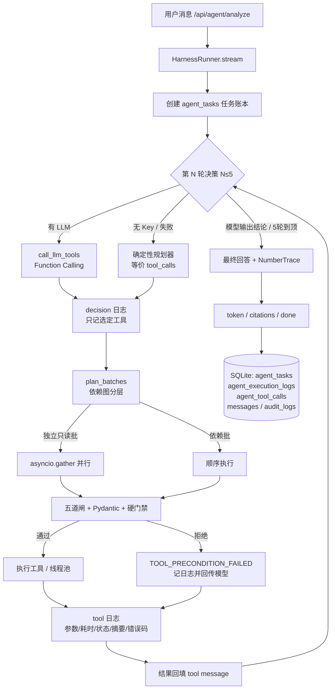

# 瀚川工业园 · 阶段7 Agent Harness 执行循环设计说明 v1.0（第一批）

> 日期：2026-11-06　基线：`aea5cfe`（阶段6 收口）
> 本批范围：**Harness 执行循环 + 工具依赖校验 + 执行日志**（用户指定的优先级）
> 运行：`cd backend && ../.venv/Scripts/python scripts/harness_selftest.py`（25 项断言全通过）

---

## 一、框架选型与理由

**选型：原生 Python 单 Agent Harness（`async while` + 状态机 + 工具注册表），不引入 LangGraph。**

理由（与项目规模 240 表 / 两栋试点 / 18 万预算 / 学生团队一致）：

| 维度 | 本方案 | LangGraph |
|---|---|---|
| 控制流 | 一个 `for round in range(1, 6)` 循环 + 依赖分层批处理，一眼看穿 | 需定义 Node/Edge/ConditionalEdge/Checkpointer，抽象层多于逻辑本身 |
| 状态 | `TaskState` 数据类 + 五道闸，门禁读状态字段 | 图状态 + reducer，调试"模型为何调错工具"要多追一层 |
| 预算上限 | 常量 `MAX_DECISION_ROUNDS=5`，到顶直接停 | 需递归限制 / 条件边配合 |
| 依赖 | 仅 FastAPI + SQLAlchemy + Pydantic（项目已有） | 新增依赖与学习成本 |
| 断点续跑 / 多 Agent | 不需要（单任务 5 轮、试点阶段） | 才是它的价值所在 |

**引入判据（沿用阶段6 第十二节）**：出现 >3 条主干条件分支拓扑、需要跨天断点续跑、或多 Agent 协作时再评估。在此之前"状态机 + 五道闸 + 一个 while"就是我们的图。

Harness 核心组成：

1. **决策器 Decider** —— 有真实 LLM 时走 Function Calling；无 Key 或调用失败时回落确定性规划器（等价 tool_calls 序列）。
2. **依赖编排器 Planner** —— `DEPENDENCIES` 依赖图 + `plan_batches()`，把一轮决策拆成「并行只读批 → 依赖批」。
3. **执行器 Executor** —— 复用阶段6 五道闸（权限/范围/前置/参数/输出），外层再加参数 Pydantic 校验与硬门禁。
4. **状态机 TaskState** —— 门禁的唯一依据；模型无写权。
5. **日志器 Logger** —— 每轮决策、每次工具调用各一行，落 `agent_execution_logs`。
6. **预算与容错** —— 5 轮上限、15 秒超时、2 次尝试、取消检测、同参缓存。

---

## 二、Harness 整体架构图



---

## 三、推荐项目目录结构（本批新增 `*`）

```
backend/
├─ app/
│  ├─ agent/
│  │  ├─ specs.py            # 8 工具 Function Calling 声明 + 权限/复核岗位/预算
│  │  ├─ tools.py            # 8 个原子工具实现（含 get_device_relationship 薄封装）
│  │  ├─ state.py            # 任务状态机
│  │  ├─ executor.py         # 五道闸 + 防循环 + 同参缓存
│  │  ├─ loop.py             # 阶段6 剧本式编排（engine=script 保留做回归对照）
│  │  ├─ schemas.py      *   # Pydantic 严格参数校验（extra=forbid，防注入）
│  │  ├─ dependencies.py *   # 依赖图 + 并行/顺序批次规划 + 硬门禁
│  │  └─ harness.py      *   # 5 轮执行循环（模型决策→校验→执行→回填→再决策）
│  ├─ api/agent.py       *   # /analyze 默认 harness、/logs 查询、/tasks 账本
│  ├─ db/models.py       *   # + AgentExecutionLog / AgentReportDraft（第二批用）
│  ├─ db/repo.py         *   # + 日志写入/筛选、草稿读写
│  ├─ templates/
│  │  └─ agent_logs.html *   # 执行日志管理页 /admin/agent-logs
│  └─ main.py                # 路由挂载（未改动路由清单，向下兼容）
└─ scripts/
   ├─ agent_selftest.py       # 阶段6 16 项（回归用）
   └─ harness_selftest.py *   # 阶段7 第一批 25 项
```

---

## 四、执行循环（关键代码位置）

主循环在 `app/agent/harness.py::HarnessRunner.stream()`，逐行中文注释，核心语义：

```text
for round_no in 1..5:
    if 取消: break
    decision = await _decide()                 # 模型决策 / 离线规划器
    if decision 是文本: final_text = decision; break
    await _log("decision", ...)               # 决策日志（不含隐藏推理）
    batches, deferred = plan_batches(calls, completed_tools)
    for batch in batches:
        results = await gather(*[_execute_one(c) for c in batch])   # 独立只读并行
        for call, result in zip(batch, results):
            emit(tool_result); 回填 tool message 给模型
else:
    unfinished_reason = "已达 5 轮模型决策上限…已完成步骤见轨迹"
输出最终回答 → NumberTrace → citations → done（含 decision_rounds / unfinished_reason）
```

`_execute_one()` 的顺序：**Pydantic 参数校验 → 依赖硬门禁 → `asyncio.wait_for` 超时 → 瞬时错误重试 1 次 → 写日志与兼容旧账本 → 状态机推进**。

---

## 五、工具集成与依赖强制

8 个工具（阶段6 的 7 个 + 按本轮需求补回 `get_device_relationship` 薄封装，内部复用
`get_meter_config` 的同一份拓扑事实，不产生第二套口径）。

| 工具 | 前置依赖 | 并行 | 门禁 |
|---|---|---|---|
| query_energy_data | — | ✅ | 权限/范围/参数 |
| get_meter_config | — | ✅ | 权限/范围/参数（倍率问题必查有效配置） |
| get_device_relationship | — | ✅ | 只读；归属不明返回 `ownership_clear=false` |
| validate_meter_data | query + config | 顺序 | 前置未满足直接 `TOOL_PRECONDITION_FAILED` |
| detect_energy_anomaly | validate **passed** | 顺序 | 校验未通过一律拒绝（物理实现"不得跳过校验"） |
| search_energy_knowledge | — | ✅ | KB 就绪检查 |
| generate_anomaly_report | query + validate + 证据非空 | 顺序 | status 只有 `draft/pending_check`，NumberTrace 不过整篇退回 |
| request_human_review | — | 顺序 | evidence_ids 必须存在于本任务证据库；状态机强制触发时编排层兜底 |

参数统一走 `schemas.validate_args()`：`extra="forbid"`，`sql / api_key / password` 等字段一律拒绝，
日志只保存校验通过后的白名单参数——**没有任意 SQL 通道**，仓库层全部 SQLAlchemy 参数化查询。

安全边界（物理性）：注册表里不存在修改原始能耗数据、控制工业设备、租户结算、异常定性、
复核签核的工具；模型幻想出工具名只会得到 `UNKNOWN_TOOL`。

---

## 六、执行日志表与筛选接口

`agent_execution_logs`（`app/db/models.py::AgentExecutionLog`）

| 字段 | 类型 | 说明 |
|---|---|---|
| id | Integer PK | 自增 |
| task_id | String(32) idx | TASK-… |
| session_id / user_id | String / Integer | 会话与发起人 |
| decision_round | Integer | 决策轮次 1–5 |
| seq | Integer | 任务内序号 |
| kind | String(16) | `decision` / `tool` |
| tool_name | String(64) | 决策行固定 `(decision)` |
| input_parameters | JSON | 白名单化后的结构化参数（无密钥/密码） |
| execution_time_ms | Integer | 工具耗时 |
| execution_status | String(16) | success / failed / timeout / cancelled / rejected / recorded |
| result_summary | String(1024) | 摘要（截断，不含全量数据） |
| error_code | String(32) NULL | 失败原因码 |
| created_at | DateTime | 执行时间 |

索引：`(task_id, decision_round, seq)`、`(user_id, created_at)`、`(tool_name, created_at)`。

接口：`GET /api/agent/logs` —— 支持 `user_id / date_from / date_to / task_id / tool_name /
decision_round / status` 组合筛选 + 分页；有 `audit:conversation:read` 看全库，否则只看本人。
管理页 `/admin/agent-logs` 直接消费该接口，与阶段5 审计链（messages / audit_logs / task_id）对齐。

**不记录**：API Key、密码、模型隐藏推理过程、提示词全文。

---

## 七、采用的默认与假设（本批）

1. 无真实 LLM Key → Function Calling 尝试失败后回落确定性规划器；工具链/门禁/日志/预算全部真实执行。
2. 用户列的 `METER_001` 在模拟数据中无对应表，映射到**唯一含倍率 10→100 变更的 M-002** 以演示真实冲突链路。
3. `get_device_relationship` 按阶段6 决策本已并入 `get_meter_config`；本轮按需求补独立只读入口，复用同一事实。
4. 数据范围（scope）仍按阶段5 预留 `all`；权限闸按权限码执行。
5. 决策轮次上限按用户要求设为 **5**，阶段6 的 12 次工具调用预算仍保留为二级保护。
6. `/api/agent/analyze` 默认切换到 Harness，`engine=script` 保留阶段6 剧本做回归对照；前端 Agent 模式无需改动。

---

## 八、第一批验收结果（25 项全通过）

`scripts/harness_selftest.py`：

- 参数严格校验（注入字段拒绝 / 越界拒绝 / 合法归一化）
- 依赖分层与并行分批（同轮无序请求仍按 query→config→validate→detect 执行）
- 正常链路：5 轮内完成、首轮 3 个只读工具并行、校验未通过时检测被门禁跳过、强制复核、
  报告 `pending_check`、数值溯源 `passed=true/checked=27`
- 日志：每轮决策 + 每次工具调用均落库、字段齐全、按轮次/按工具筛选生效、无敏感信息
- 预算：到 5 轮自动停止并说明未完成原因与已完成步骤
- 容错：超时有 `TIMEOUT` 状态并写日志；取消检测终止自动执行
- 接口：`/api/agent/logs` 可查、可按工具筛选、权限范围正确
- 回归：阶段6 `scripts/agent_selftest.py` 16 项仍全通过

---

## 九、剩余事项（后续批次）

- **第二批**：`generate_anomaly_report` 草稿经 SSE 流式下发 → 暂停 → 前端"确认提交人工复核 / 取消"
  → 后端二次校验（身份/权限/报告版本/证据有效性）→ `request_human_review`；
  幂等键防重复确认；强制复核风险在用户取消时独立保留。
- **第三批**：场景 A/B/C 完整联调轨迹、前端确认按钮、验收文档与运行说明、全量回归与推送。
- **明确不做**（沿用阶段6 边界）：LangGraph / 多 Agent / scope 收紧 / 真实 LLM 下自主规划复测。
